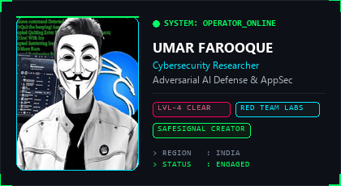

<div align="center">

<!-- CINEMATIC CYBER PROFILE HERO BANNER -->
<a href="https://github.com/UmarFarooqueJi">
  
</a>

<br/>

<!-- ANIMATED NEON CYBER DIVIDER -->


<br/>

#  Umar Farooque
### 🤖 AI Security & LLM Threat Defense • 🛡️ Adversarial Red Teaming • ⚡ SafeSignal Author

<br/>

<!-- DYNAMIC TERMINAL TYPING ANIMATION -->
<a href="https://github.com/UmarFarooqueJi">
  
</a>

<br/>

<!-- SYSTEM STATUS & TELEMETRY RADAR -->
[]()
[]()
[]()
[](https://github.com/UmarFarooqueJi/SafeSignal)
[]()
[]()
[]()

</div>

<br/>

<!-- ANIMATED NEON DIVIDER -->


---

## ⚡ Operational Mission & Security Focus

<table border="0" style="border-collapse: collapse; width: 100%;">
<tr>
<td width="62%" valign="top">

```ini
[RESEARCHER: UMAR_FAROOQUE]
LOCATION   = India 🇮🇳
CORE_FOCUS = Adversarial AI & LLM Security • Prompt Injection Defense • Agentic AI Safety
SECONDARY  = Application Security (OWASP Top 10) • Mobile Cryptography & Hardening
RESEARCH   = Direct/Indirect Prompt Injection • Jailbreak Containment • RAG Poisoning
FLAGSHIP   = SafeSignal — On-Device ML Text Recognition & Scam Interceptor
TOOLCHAIN  = Python • PyTorch • LangChain • Linux/Bash • Dart/Flutter • Supabase RLS
```

- 🤖 **Adversarial AI & LLM Security:** Researching and engineering defensive guardrails against **Direct & Indirect Prompt Injection**, Jailbreak containment, System Prompt extraction, RAG retrieval poisoning, and LLM output manipulation.
- 🛡️ **Agentic AI Safety & Tool Sandboxing:** Developing policy-constrained boundary guards for autonomous tool-calling agents, parameter validation, and execution isolation.
- 📱 **Mobile & Application Security:** Focused on Android APK reverse-engineering, manifest permissions, broadcast receivers, and OWASP Top 10 mobile/web attack vectors.
- 🔐 **Cryptographic Storage & Hardware Anchors:** Implementation of authenticated `AES-256-GCM` encryption anchored via Android KeyStore, secure memory streaming, and privacy-first architectures.
- 🚀 **Flagship Engineering — SafeSignal:** Author of **[SafeSignal](https://github.com/UmarFarooqueJi/SafeSignal)** — an open-source Android cyber defense engine featuring on-device Google ML Kit OCR, phishing radar, DLT-compliant SMS filters, and incident response routing.
- ⚙️ **Security Automation & Tooling:** Designing hardened automation pipelines with **Python**, **Bash**, REST APIs, and **Supabase (PostgreSQL with Row Level Security)**.

</td>
<td width="38%" valign="top" align="center">


<br/><br/>

[](https://github.com/UmarFarooqueJi/SafeSignal)

</td>
</tr>
</table>

---

## 🧠 Adversarial AI & LLM Security Matrix

<div align="center">

| Threat Vector (OWASP for LLMs) | Attack Surface & Vulnerability Context | Defensive Architecture & Countermeasure |
| :--- | :--- | :--- |
| **🛡️ Prompt Injection (LLM01)** | Direct jailbreak prefixes, indirect prompt injection via poisoned web/PDF data, base64 payloads | Multi-layer input sanitization, instruction-data isolation wrappers, dual-evaluator safety gates |
| **🔍 Insecure Output Handling (LLM02)** | Model emitting unsanitized XSS, raw SQL injections, or unvalidated CLI system commands | Strict typed JSON Schema validation (Pydantic), AST parsing, sandboxed downstream execution |
| **📚 RAG & Context Poisoning (LLM03)** | Adversaries corrupting vector stores or external retrieval documents with adversarial text | Document SHA-256 hash pinning, retrieval similarity threshold gating, cross-source citation checks |
| **⚡ Model Denial of Service (LLM04)** | Resource exhaustion via context window blowout, recursive loops & algorithmic complexity | Token-bucket rate limiters, hard context caps, max-depth recursion limits & timeout circuit breakers |
| **🕵️ System Prompt & Data Leakage (LLM06)** | Reconnaissance prompts attempting to extract proprietary system instructions or training data | Output regex filters, zero-retrieval system anchors, canary token tripwires |
| **🤖 Autonomous Agent Hijacking (LLM08)** | LLM tool-calling agents manipulated into unauthorized file read, destructive API calls, or egress | Deterministic human-in-the-loop approvals, read-only privilege defaults, strict tool parameter schemas |

<br/>

[](https://owasp.org/www-project-top-10-for-large-language-model-applications/)
[]()
[]()
[]()

</div>

---

## 🛠️ Security Arsenal & Technical Stacks

### 💻 Core Programming & Scripting
<div align="center">
  <a href="https://skillicons.dev">
    
  </a>
</div>

<br/>

### 🛡️ Offensive & Defensive Cybersecurity Toolchain
<div align="center">
  <a href="https://skillicons.dev">
    
  </a>
</div>

<br/>

<div align="center">

[](https://portswigger.net/burp)
[](https://www.wireshark.org/)
[](https://nmap.org/)
[](https://owasp.org/)
[](https://metasploit.com/)
[](https://mobsf.github.io/)
[](https://apktool.org/)
[](https://www.autopsy.com/)
[](https://sqlmap.org/)

</div>

<br/>

### ☁️ Cloud, Databases, Mobile & Agentic Frameworks
<div align="center">
  <a href="https://skillicons.dev">
    
  </a>
</div>

<br/>

<div align="center">

[](https://ai.google.dev/)
[]()
[]()
[]()

</div>

---

## 🔬 Flagship Spotlight: SafeSignal

<div align="center">

<a href="https://github.com/UmarFarooqueJi/SafeSignal">
  
</a>

<br/><br/>

| Pipeline Stage | Functionality | Technologies |
| :--- | :--- | :--- |
| **📥 Telemetry Ingestion** | Intake of suspicious SMS payloads, DLT headers, call metadata & fraud screenshots | `Android Broadcast Receivers`, `Google ML Kit (C++)` |
| **⚡ Heuristic Triage** | Punycode/IDN homograph detection, known scam signature hashing & Cloudflare DoH | `Dart/Flutter`, `Cloudflare DoH`, `Hash Indexes` |
| **🧠 Threat & Policy Engine** | Social engineering pattern matching, urgency tone detection & policy-driven intent triage | `Heuristic Policy Engine`, `Multi-Tier Rule Matrix` |
| **🔐 Hardware Vault & Alert** | Authenticated AES-256-GCM encrypted storage & plain-language safety countermeasures | `Android KeyStore`, `AES-256-GCM`, `Flutter UI` |

</div>

---

## 📊 Live GitHub Telemetry & Stats

<div align="center">

<table border="0" style="border-collapse: collapse; width: 100%;">
<tr>
<td width="50%" valign="top" align="center">

<a href="https://github.com/UmarFarooqueJi">
  
</a>

<br/><br/>

<a href="https://github.com/UmarFarooqueJi">
  
</a>

</td>
<td width="50%" valign="top" align="center">

<a href="https://github.com/UmarFarooqueJi">
  
</a>

<br/><br/>

<!-- AUTHENTIC CYBER OPERATOR HUD CARD -->
<a href="https://github.com/UmarFarooqueJi">
  
</a>

</td>
</tr>
</table>

</div>

---

## 🐍 Contribution Activity Stream

<div align="center">

<picture>
  <source media="(prefers-color-scheme: dark)" srcset="https://raw.githubusercontent.com/UmarFarooqueJi/Umarfarooqueji/output/github-contribution-grid-snake-dark.svg?v=20260925">
  <source media="(prefers-color-scheme: light)" srcset="https://raw.githubusercontent.com/UmarFarooqueJi/Umarfarooqueji/output/github-contribution-grid-snake.svg?v=20260925">
  
</picture>

</div>

---

## 🌐 Secure Communications & Social Uplinks

<div align="center">

<!-- ANIMATED NEON DIVIDER -->


<br/><br/>

[](https://linkedin.com/in/umar-farooque-cyber)
[](https://github.com/UmarFarooqueJi)
[](mailto:umarfarooqueji@gmail.com)
[](https://github.com/UmarFarooqueJi/SafeSignal)

<br/><br/>

```text
[UMAR FAROOQUE] — Open to Adversarial AI Security research, Application Security engineering & mobile defense collaborations.
```

<!-- ANIMATED FOOTER WAVE -->


</div>
