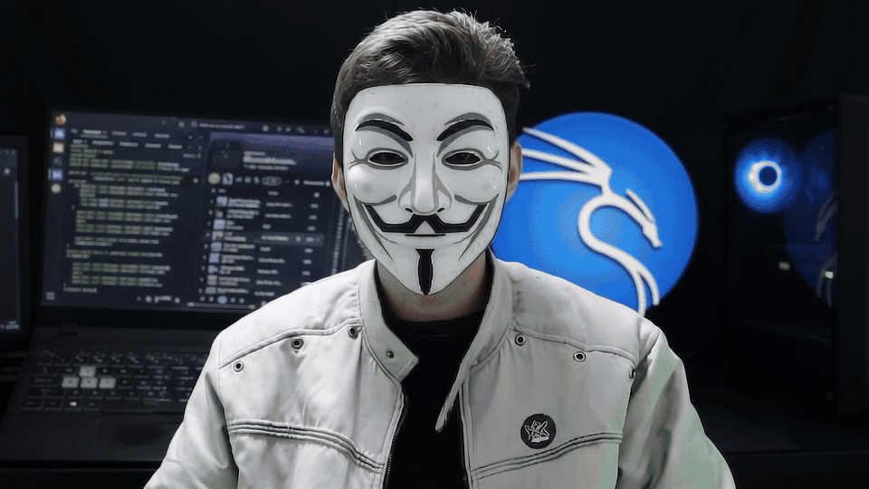
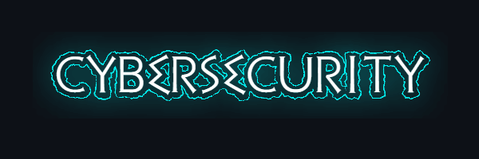

<div align="center">

<!-- CINEMATIC CYBER PROFILE HERO BANNER -->
<a href="https://github.com/UmarFarooqueJi">
  
</a>

<br/>

<!-- ANIMATED NEON CYBER DIVIDER -->


<br/>

#  Umar Farooque
### 🛡️ Cybersecurity Researcher • 🤖 AI Threat Defense • ⚡ SafeSignal Creator

<br/>

<!-- DYNAMIC TERMINAL TYPING ANIMATION -->
<a href="https://github.com/UmarFarooqueJi">
  
</a>

<br/>

<!-- SYSTEM STATUS & TELEMETRY RADAR -->
[]()
[]()
[]()
[]()
[]()

</div>

<br/>

<!-- ANIMATED NEON DIVIDER -->


---

## ⚡ Operational Mission & Security Focus

<table border="0" style="border-collapse: collapse; width: 100%;">
<tr>
<td width="62%" valign="top">

```ini
[OPERATOR_IDENT: UMAR_FAROOQUE]
LOCATION   = India 🇮🇳
CORE_FOCUS = Adversarial AI Defense | Application Security | Threat Hunting
FLAGSHIP   = SafeSignal — Sub-Second Multi-Tier AI Scam Interceptor
STACK      = Kali Linux • Python • Flutter • Dart • Supabase • REST APIs
```

- 🛡️ **AppSec & Red Teaming:** Rigorous penetration testing across **OWASP Top 10**, Web Application Security, Android APK decompilation, Manifest auditing, and Network Footprinting.
- 🤖 **Adversarial AI & LLM Hardening:** Investigating and engineering defenses against **Direct & Indirect Prompt Injections**, Jailbreak payload containment, System Prompt leakage, and RAG retrieval poisoning.
- 🚀 **Flagship Engineering:** Author of **[SafeSignal](https://github.com/UmarFarooqueJi/SafeSignal)** — an open-source, multi-tier agentic engine intercepting deceptive voice calls, phishing SMS, and fraud screenshots with sub-second AI triage.
- ⚙️ **Security Automation & Tooling:** Designing hardened automation pipelines with **Python**, **Bash**, hardened REST APIs, and **Supabase (PostgreSQL with Row Level Security)**.

</td>
<td width="38%" valign="top" align="center">



<br/><br/>

[](https://github.com/UmarFarooqueJi/SafeSignal)

</td>
</tr>
</table>

---

## 🛠️ Security Arsenal & Technical Stacks

### 💻 Core Programming & Scripting
<div align="center">
  <a href="https://skillicons.dev">
    
  </a>
</div>

<br/>

### 🛡️ Offensive & Defensive Cybersecurity Toolchain
<div align="center">
  <a href="https://skillicons.dev">
    
  </a>
</div>

<br/>

<div align="center">

[](https://portswigger.net/burp)
[](https://www.wireshark.org/)
[](https://nmap.org/)
[](https://owasp.org/)
[](https://metasploit.com/)
[](https://mobsf.github.io/)
[](https://apktool.org/)
[](https://www.autopsy.com/)
[](https://sqlmap.org/)

</div>

<br/>

### ☁️ Cloud, Databases, Mobile & Agentic Frameworks
<div align="center">
  <a href="https://skillicons.dev">
    
  </a>
</div>

<br/>

<div align="center">

[](https://ai.google.dev/)
[]()
[]()
[]()

</div>

---

## 🔬 Flagship Spotlight: SafeSignal

<div align="center">

<a href="https://github.com/UmarFarooqueJi/SafeSignal">
  
</a>

<br/><br/>

| Pipeline Stage | Functionality | Technologies |
| :--- | :--- | :--- |
| **📥 Telemetry Ingestion** | Real-time intake of suspicious voice transcripts, SMS payloads & fraud screenshots | `Android Background Listeners`, `OCR` |
| **⚡ Sub-Second Triage** | Fast signature hashing, known scam phone lists & domain reputation lookup (<300ms) | `Python`, `Supabase RLS`, `Hash Indexes` |
| **🧠 Adversarial AI Reasoning** | Deep semantic LLM verification against social engineering patterns & urgent tone hooks | `Google Gemini`, `LangChain`, `RAG Vectors` |
| **🛡️ Vernacular Defense Alert** | Actionable plain-language safety countermeasures delivered in Hindi & English | `Flutter Frontend`, `Secure Push Dispatch` |

</div>

---

## 📊 Live GitHub Telemetry & Stats

<div align="center">

<table border="0" style="border-collapse: collapse; width: 100%;">
<tr>
<td width="50%" valign="top" align="center">

<a href="https://github.com/UmarFarooqueJi">
  
</a>

<br/><br/>

<a href="https://github.com/UmarFarooqueJi">
  
</a>

</td>
<td width="50%" valign="top" align="center">

<a href="https://github.com/UmarFarooqueJi">
  
</a>

<br/><br/>

<!-- ANIMATED CYBER HACKER STICKER -->


</td>
</tr>
</table>

</div>

---

## 🐍 Contribution Activity Stream

<div align="center">

<picture>
  <source media="(prefers-color-scheme: dark)" srcset="https://raw.githubusercontent.com/UmarFarooqueJi/Umarfarooqueji/output/github-contribution-grid-snake-dark.svg?v=20260925">
  <source media="(prefers-color-scheme: light)" srcset="https://raw.githubusercontent.com/UmarFarooqueJi/Umarfarooqueji/output/github-contribution-grid-snake.svg?v=20260925">
  
</picture>

</div>

---

## 🌐 Secure Communications & Social Uplinks

<div align="center">

<!-- ANIMATED NEON DIVIDER -->


<br/><br/>

[](https://linkedin.com/in/umar-farooque-cyber)
[](https://github.com/UmarFarooqueJi)
[](mailto:umarfarooqueji@gmail.com)
[](https://github.com/UmarFarooqueJi/SafeSignal)

<br/><br/>

```text
[OPERATOR: UMAR FAROOQUE] — Open to AppSec research collaborations, Adversarial AI defense experiments & Red Team labs.
```

<!-- ANIMATED FOOTER WAVE -->


</div>
